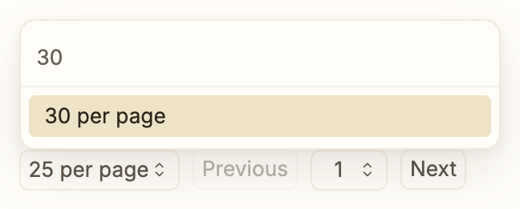
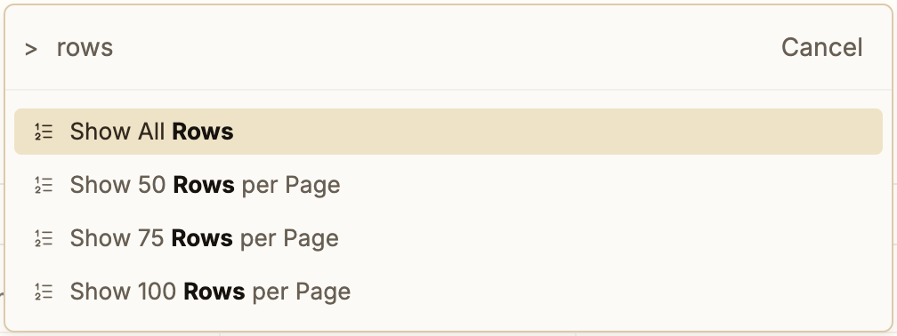

# Table Tweaks

Small improvements to [Thymer](https://thymer.com)'s built-in **Table** view. They apply to
every table in your workspace. Your tables, columns and data stay exactly as they are; the
plugin only changes how paging, the header and a few keys behave.

## Install

1. In Thymer, open the command palette (⌘P), choose **Plugins → Create Plugin**.
2. Open **Edit Code → Custom Code** and paste the contents of
   [`dist/plugin.js`](dist/plugin.js).
3. Paste [`plugin.json`](plugin.json) into **Configuration**, and save.

Other devices pick the plugin up after a reload (⌘R).

## What's different from the native table

### Choose how many rows each page shows

Native tables always show 75 rows per page. With Table Tweaks, each view keeps its own
page size: 25, 50, 75, 100, all rows, or any number you like.

Next to **Previous / Next** at the bottom of the table there's a new **"… per page"**
button. Pick a size from the list, or type a number into its search field and press
Enter:



You can also do it from the keyboard: click into the table, open the command palette
(⌘P) and type "rows":



- The choice is saved with the view, so it's still there after a reload and syncs to
  your other devices. Two views of the same collection can use different sizes.
- Choosing 75 goes back to Thymer's default.
- When everything fits on one page, Thymer normally hides the paging bar. Table Tweaks
  keeps a small bar with the item count and the page-size button, as long as the table
  has more than 25 rows, so you can always switch back.

### Turn pages from the keyboard

- **⌥← / ⌥→** (Option + arrow keys) go to the previous / next page. If a cell is
  selected, you land on the same row of the new page, in the same column.
- The status bar at the bottom of the window shows which page you're on, for example
  **"97 items · Page 2 of 4"**, and lists the keys as a hint. Hovering over Previous or
  Next also shows them.
- To use different keys, open ⌘P → **Change Keyboard Shortcuts** and add, for example:

  ```
  "plugin.table_prev_page": "Alt+Shift+ArrowLeft",
  "plugin.table_next_page": "Alt+Shift+ArrowRight",
  ```

  Set a key to `""` to turn it off.

### A column header that stays put

When you scroll down a long table, Thymer pins the column header to the top. In the native
table the header briefly gets dragged along with the rows and snaps back on every scroll
step, so it flickers. With Table Tweaks it stays still until you scroll back up. (Not on
phone-sized layouts, where the header behaves natively.)

## Turning it off

Disable or delete the plugin. Open tables go straight back to native behavior: 75 rows
per page, Thymer's own header and keys. Page sizes you chose stay saved in your views and
come back if you turn the plugin on again.

## How it works (for the curious)

Thymer doesn't yet offer plugins an official way to change its built-in table, so Table
Tweaks works with the app's own internal code. It does so carefully:

1. **It waits for a table.** When the plugin starts, or later when the first table opens,
   it looks up the code "blueprint" (the class) that every native table is built from,
   and the one that builds every table's paging bar.
2. **It wraps a few functions on those blueprints.** Each wrapped function runs
   Thymer's original first, then adds the tweak: a different page size, the page number
   in the status bar, the extra page keys, the steadier header. Because every table
   uses the same blueprint, every table gets the tweaks: the ones already open (refreshed
   once) and every table opened afterwards. A new table comes up at your chosen page
   size from its first frame.
3. **It stays out of other views.** Lists, galleries and the Tasks panel share the
   paging-bar blueprint, so those wrappers check whether the paging bar belongs to a
   table and otherwise leave it alone.
4. **It adds, it doesn't rewrite.** The page-size button goes into the paging bar while
   Thymer is drawing it, so it is part of each fresh redraw. Nothing Thymer has already
   put on screen is edited.
5. **It fails safe.** If a tweak ever runs into an error, Thymer's original behavior
   runs instead. Turning the plugin off puts Thymer's original functions back. Thymer is
   in alpha and its internals change. The plugin checks for everything it relies on
   before doing anything. If an update renamed something, your tables stay native and
   Thymer shows a "Table Tweaks needs updating" notice instead.

The page size lives in the view's own settings (as `page_size`), which is why it syncs
like the rest of the view.
